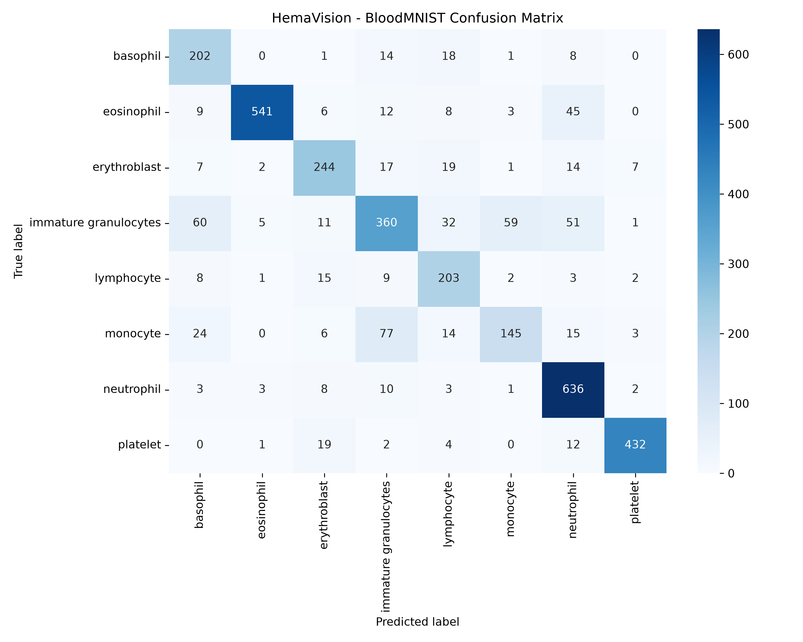
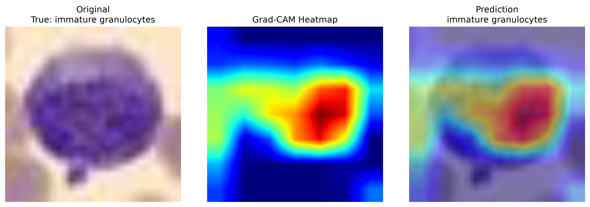

# HemaVision

## Blood Cell Classification with Transfer Learning

HemaVision is a research/educational computer vision project for
multi-class blood-cell image classification using transfer learning.

The project explores how pretrained deep learning models can be adapted
to biomedical image classification while addressing class imbalance,
model evaluation, error analysis, and model interpretability.

> **Disclaimer:** HemaVision is an educational/research project and is
> not intended for clinical diagnosis or medical decision-making.

---

## Objectives

- Apply transfer learning to biomedical images
- Fine-tune a pretrained EfficientNet model
- Handle class imbalance using class-weighted loss
- Evaluate performance using multiple metrics
- Analyze classification errors using a confusion matrix
- Use Grad-CAM for model explainability
- Build an interactive Streamlit inference application

---

## Dataset

The project uses **BloodMNIST** from the MedMNIST collection.

The dataset contains:

- 17,092 images
- 8 blood-cell classes
- 11,959 training images
- 1,712 validation images
- 3,421 test images

### Classes

1. Basophil
2. Eosinophil
3. Erythroblast
4. Immature granulocytes
5. Lymphocyte
6. Monocyte
7. Neutrophil
8. Platelet

The original BloodMNIST images are 28×28 pixels and are resized to
224×224 pixels for EfficientNet-B0.

---

## Model

HemaVision uses **EfficientNet-B0 pretrained on ImageNet**.

The pretrained backbone is initially frozen and a new classifier is
trained for the eight BloodMNIST classes.

### Transfer learning pipeline

BloodMNIST image

↓

Image preprocessing and augmentation

↓

Pretrained EfficientNet-B0

↓

8-class classifier

↓

Blood-cell prediction

---

## Class Imbalance

The training dataset contains different numbers of samples per class.

To reduce the effect of class imbalance, HemaVision uses
**class-weighted cross-entropy loss** during training.

---

## Training

The model was trained for 5 epochs using:

- PyTorch
- Adam optimizer
- Learning rate: 0.001
- Batch size: 32
- Class-weighted cross-entropy
- CPU training

---

## Results

The final model was evaluated on the unseen BloodMNIST test set.

| Metric | Result |
|---|---:|
| Accuracy | **84.22%** |
| Macro F1 | **81.89%** |
| Balanced Accuracy | **83.01%** |

### Best-performing classes

| Class | F1-score |
|---|---:|
| Platelet | 96.89% |
| Eosinophil | 95.69% |
| Neutrophil | 91.32% |

### More challenging classes

| Class | F1-score |
|---|---:|
| Monocyte | 64.58% |
| Immature granulocytes | 69.66% |
| Basophil | 73.65% |

The confusion matrix shows systematic confusion between visually similar
cell categories, particularly monocytes and immature granulocytes.



---

## Explainability with Grad-CAM

HemaVision uses **Grad-CAM** to visualize the image regions that
contribute most strongly to a model prediction.

Example:



Grad-CAM provides an interpretation of where the model is focusing,
but the highlighted regions should not be interpreted as medically
validated diagnostic features.

---

## Streamlit Application

HemaVision includes an interactive Streamlit application.

The application allows users to:

1. Upload a blood-cell image
2. Obtain the predicted class
3. View prediction confidence
4. View class probabilities
5. Visualize a Grad-CAM heatmap
6. View the Grad-CAM overlay

Run the application with:

```bash
streamlit run app/app.py
